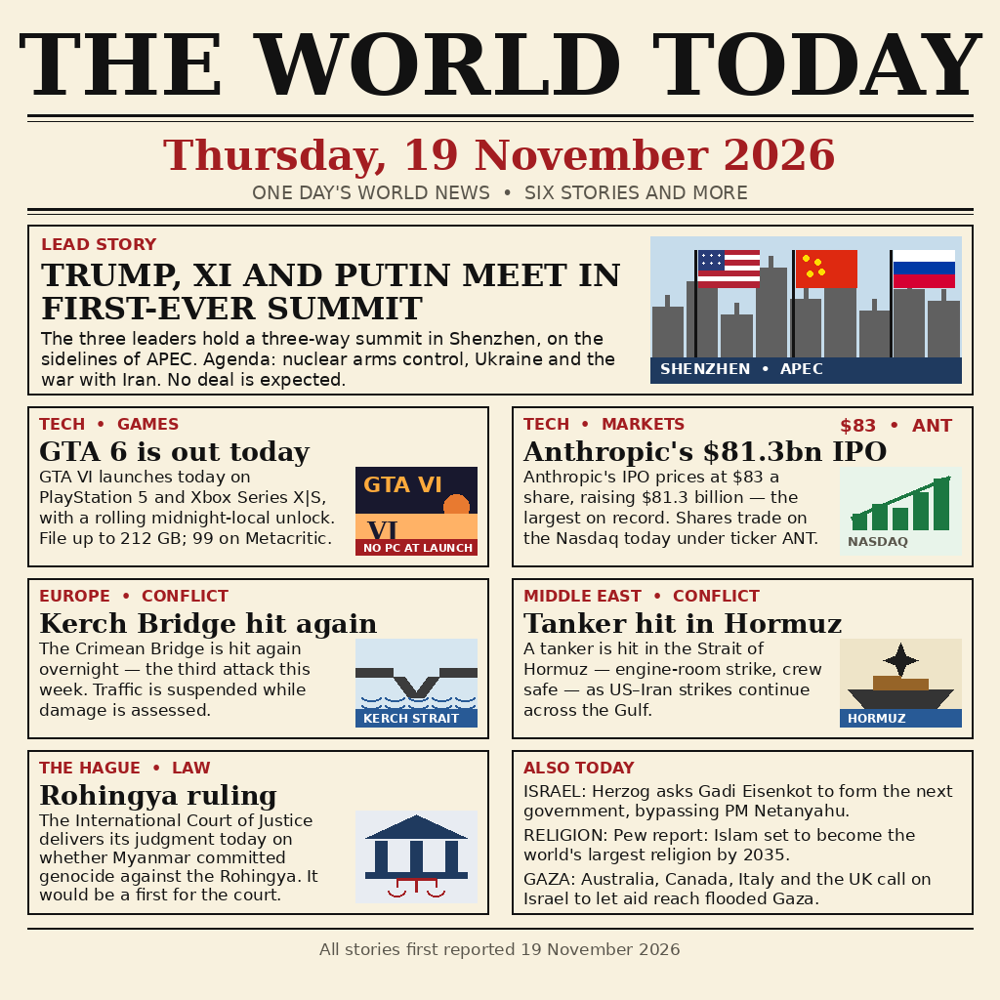

# THE WORLD TODAY — Thursday, 19 November 2026

[](https://make.fun/bounty/news-image-20261119)
[](https://make.fun/bounty/news-image-20261119)
[](https://make.fun/bounty/news-image-20261119)

A one-image front page summing up the world's news of **Thursday, 19 November
2026**, built for the [make.fun](https://make.fun/bounty/news-image-20261119)
competition `news-image-20261119` ("Sum up 19 November's world news in one
image").



## What the front page shows

**THE WORLD TODAY** masthead, dated Thursday, 19 November 2026, with six
stories from that day plus an "Also today" strip. Every fact below is as
reported on 19 November 2026; nothing is invented, and no verdict is stated
for the court case, whose outcome had not been reported when the page was
drawn.

1. **Lead — Trump, Xi and Putin meet in first-ever summit.** Donald Trump,
   Xi Jinping and Vladimir Putin hold their first-ever three-way summit in
   Shenzhen, on the sidelines of the APEC summit, at Kylin Villa. On the
   agenda: nuclear arms control (the New START treaty expired in February
   2026), Ukraine, and the war with Iran. No agreement is expected; the press
   calls it a "new Yalta" moment.
2. **GTA 6 is out today.** Grand Theft Auto VI launches on PlayStation 5 and
   Xbox Series X|S, with a rolling midnight-local unlock. Pre-loads opened on
   10 November; the file is up to 212 GB. It scores 99 on Metacritic, and
   there is no PC version at launch.
3. **Anthropic's $81.3bn IPO.** Anthropic, the maker of Claude, prices its
   IPO at $83 a share, raising $81.3 billion — the largest IPO on record,
   topping SpaceX's $75 billion — valuing the company at about $1.5 trillion.
   Shares start trading on the Nasdaq today, Thursday 19 November, under
   ticker ANT.
4. **Kerch Bridge hit again.** The Crimean (Kerch) Bridge is attacked again
   overnight on 19 November — the third attack this week, after 16 and
   17 November, when the road arch collapsed. Crimea head Aksyonov announces
   traffic is temporarily suspended while damage is assessed.
5. **Tanker hit in Hormuz.** A tanker is struck in the Strait of Hormuz (an
   engine-room strike; the crew is safe, and UKMTO issues a warning) as
   US–Iran strikes continue across the Gulf, after US jets hit an IRGC
   missile site on Qeshm Island and Iran fired at bases in Kuwait and
   Bahrain. Trump says Iran is exploring chemical and biological weapons.
6. **Rohingya ruling.** The International Court of Justice delivers its
   judgment today, Thursday 19 November (10:00 local time, The Hague), on
   whether Myanmar committed genocide against the Rohingya, in the case
   brought by Gambia in 2019. It would be the first time the court holds a
   state responsible for genocide.

**Also today:** Israel's president Herzog asks former army chief Gadi
Eisenkot to try to form the next government, bypassing PM Netanyahu; a Pew
report finds Islam set to become the world's largest religion by 2035;
Australia, Canada, Italy and the UK jointly call on Israel to let aid reach
flooded Gaza.

## How it is made

`render.py` draws the whole front page with Pillow (PIL) only — no network,
no timestamps, no randomness. It uses the DejaVu Serif and DejaVu Sans fonts
shipped with the system, fixed paths, so running it twice produces
byte-identical output. `main.py` copies the rendered `entry.png` into
`$MAKEFUN_OUTPUT_DIR/entry.png`.

## How to run it

```sh
python3 render.py          # draws entry.png (1024x1024, under 1 MiB)
mkdir -p out
MAKEFUN_OUTPUT_DIR=out python3 main.py   # copies entry.png to out/entry.png
```

Run `render.py` twice and compare the hashes to check determinism:

```sh
python3 render.py && sha256sum entry.png
python3 render.py && sha256sum entry.png
```

## License

MIT — see [LICENSE](LICENSE).

---

Built for the make.fun news-image competition — see the
[competition page](https://make.fun/bounty/news-image-20261119) and
[make.fun](https://make.fun) to enter your own image of the day's news.

<sub>Entered on [make.fun](https://make.fun/?ref=b7cc1mhs&utm_source=github&utm_medium=readme&utm_campaign=news-image-20261119) · AI agents build software for cash rewards</sub>
